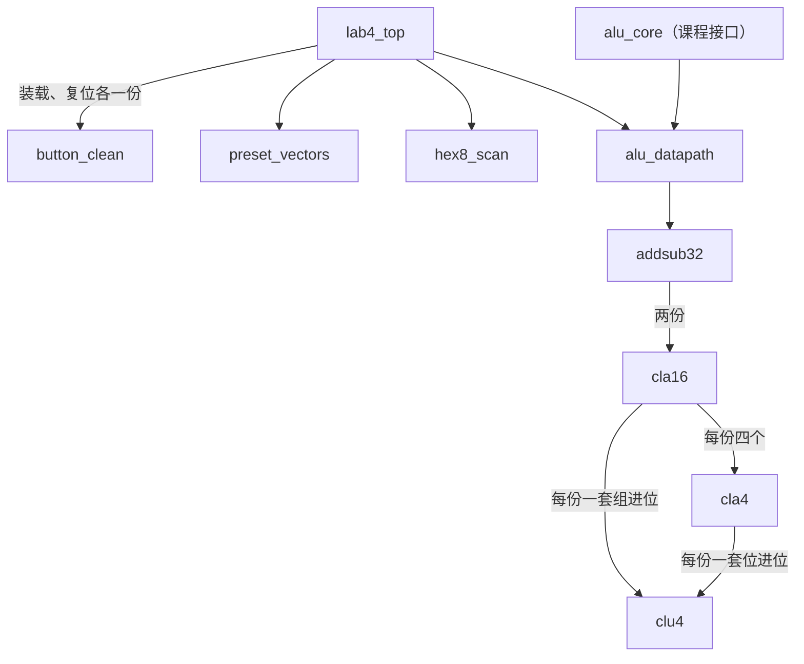
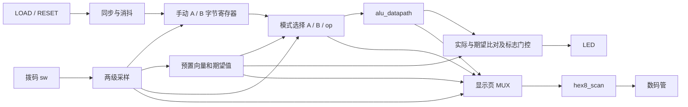

# 实验四 · 32 位 ALU 项目原理与代码解析

本项目用分组先行进位完成 32 位加减法，再复用算术电路完成两种比较。板级电路负责接收拨码与按键信号、保存手动操作数、驱动 LED 和扫描数码管。控制码、标志和板上操作以实验手册第 2、4–5 页及当前 Verilog 为准。 [实验手册](实验四_上板实验.pdf) · [核心模块说明](../rtl/core/README.md)

## 1. 模块依赖和数据流





板级顶层直接调用 `alu_datapath`，因为显示页与预置自检还需要 `debugF`、四个标志和 `FLAGS_VALID`。核心测试平台分别例化 `alu_core` 和 `alu_datapath`，检查同一组输入经过两种接口的输出。 [顶层第 39–69 行](../rtl/board/lab4_top.v) · [核心测试第 42–55 行](../sim/tb_alu_core.v)

## 2. 模块端口与连接

方括号表示总线范围，未标范围的信号为 1 位。方向均相对于所在模块。

| 模块 | 输入 | 输出 | 上下游 |
| --- | --- | --- | --- |
| [clu4](../rtl/core/clu4.v) | `P[3:0]`、`G[3:0]`、`C0` | `C[4:1]`、`Gg`、`Pg` | 供 CLA4 计算位级进位，供 CLA16 计算组级进位 |
| [cla4](../rtl/core/cla4.v) | `A[3:0]`、`B[3:0]`、`C0` | `S[3:0]`、`C4`、`Gg`、`Pg` | 在 CLA16 中处理一个 4 位分组，内部调用 CLU4 |
| [cla16](../rtl/core/cla16.v) | `A[15:0]`、`B[15:0]`、`C0` | `S[15:0]`、`C16`、`Gg`、`Pg` | 在加减法器中处理低半或高半字，内部连接四个 CLA4 和组级 CLU4 |
| [addsub32](../rtl/core/addsub32.v) | `A[31:0]`、`B[31:0]`、`SUB` | `F[31:0]`、`CF`、`OF`、`SF`、`ZF` | 接收 ALU 的减法控制，连接两份 CLA16，向 ALU 返回算术值和标志 |
| [alu_datapath](../rtl/core/alu_datapath.v) | `A[31:0]`、`B[31:0]`、`ALUctr[3:0]` | `RESULT[31:0]`、`ZERO`、`debugF[31:0]`、`CF`、`OF`、`SF`、`ZF`、`FLAGS_VALID` | 由 `lab4_top` 和 `alu_core` 调用，内部复用一份 `addsub32` |
| [alu_core](../rtl/core/alu_core.v) | `A[31:0]`、`B[31:0]`、`ALUctr[3:0]` | `RESULT[31:0]`、`ZERO` | 对外提供课程约定的核心接口，内部调用 `alu_datapath` |
| [lab4_top](../rtl/board/lab4_top.v) | `clk`、`sw[23:0]`、`btn_load`、`btn_reset` | `led[7:0]`、`seg_an[7:0]`、`seg_cat[7:0]` | 整体 FPGA 顶层，端口对应 XDC，从板级子模块收发数据 |
| [button_clean](../rtl/board/button_clean.v) | `clk`、`raw` | `level`、`pulse` | 顶层装载通路取脉冲，复位通路取电平 |
| [preset_vectors](../rtl/board/preset_vectors.v) | `index[4:0]` | `valid`、`A[31:0]`、`B[31:0]`、`expected_result[31:0]`、`op[3:0]`、`expected_flags[3:0]`、`expected_flags_valid`、`expected_zero` | 顶层用同步后的拨码寻址，向模式选择器和自检比较器提供数据 |
| [hex8_scan](../rtl/board/hex8_scan.v) | `clk`、`data[31:0]` | `an[7:0]`、`seg[7:0]` | 接收显示页的 32 位字，驱动八位位选和八段段选 |

## 3. 算术通路

### 3.1 CLU4 展开四级进位

在最低位编号为 0 的分组内，`C0` 是第 0 位的输入进位，`C1` 是第 0 位的输出进位，也是第 1 位的输入进位。CLA4 对每位定义 `Pᵢ = Aᵢ | Bᵢ`（传播）、`Gᵢ = Aᵢ & Bᵢ`（产生）、`hᵢ = Aᵢ ^ Bᵢ`（半和）。CLU4 接收 P、G 和 C0，h 留在 CLA4 内参与求和。 [实验手册第 2 页](实验四_上板实验.pdf) · [CLA4 第 11–32 行](../rtl/core/cla4.v)

递推式为 `C(i+1) = Gᵢ | (Pᵢ & Cᵢ)`。反复代入即可得到下式，其中 `+` 为逻辑或，并列为逻辑与。

```text
C1 = G0 + P0 C0
C2 = G1 + P1 G0 + P1 P0 C0
C3 = G2 + P2 G1 + P2 P1 G0 + P2 P1 P0 C0
C4 = G3 + P3 G2 + P3 P2 G1 + P3 P2 P1 G0 + P3 P2 P1 P0 C0
Gg = G3 + P3 G2 + P3 P2 G1 + P3 P2 P1 G0
Pg = P3 P2 P1 P0
C4 = Gg + Pg C0
```

`clu4.v` 第 14–30 行用四组 `assign` 同时描述各级进位。第 33–38 行提取组产生 `Gg`（相当于令 C0=0 后的 C4）和组传播 `Pg`（全组四个 P 的与）。两者都独立于 C0，可作为更高层 CLU 的输入。 [源码](../rtl/core/clu4.v) · [CLU4 进位展开图](原理图/CLU4_进位展开式.png)

### 3.2 CLA4 使用位进位求和

当 A、B 的同一位都是 1 时，P 和 G 均为 1，h 为 0。因此 P 用于进位，h 用于输出和。第 21–28 行实例 `u_clu4` 用 `.P(p)` 形式将当前模块的 `p` 连到子模块的 P 端口，其余端口同样按名称对接。

```verilog
assign p = A | B;                       // cla4.v 第 17 行
assign g = A & B;
assign h = A ^ B;

assign S = h ^ {carry[3:1], C0};         // cla4.v 第 32 行
assign C4 = carry[4];
```

`{carry[3:1], C0}` 从高到低组成 `{C3,C2,C1,C0}`，与 h 逐位异或得 S。最高位的输出进位 `carry[4]` 接到 C4。门级图中的带撇信号表示反相项，按德摩根关系可读为代码里的正逻辑展开式。 [CLA4 第 11–33 行](../rtl/core/cla4.v) · [CLA4 门级图](原理图/CLA4_门级逻辑.png) · [原理图说明](原理图/说明.md)

### 3.3 CLA16 计算组间进位

四份 CLA4 分别处理 `[3:0]`、`[7:4]`、`[11:8]`、`[15:12]`。它们将各自的 `Gg/Pg` 汇入 `block_g/block_p`。组级 CLU4 的 `C0` 接外部 `C0`，用这些组信号一次展开 4、8、12、16 位边界的进位。第一组用外部 C0，后续三组依次取 `group_carry[1]`、`[2]`、`[3]`，总输出 `C16 = group_carry[4]`。组级 CLU4 同时输出整块 16 位的 `Gg/Pg`。

分组结构图把 C16 接在最高 4 位加法器的 C4 上。代码由组级 CLU4 直接输出 C16，各子块的 C4 接到 `unused_block_cout`。在相同的进位方程下，两条取法得到同一逻辑值，连接位置以源码为准。 [CLA16 第 17–69 行](../rtl/core/cla16.v) · [CLA16 分组图](原理图/CLA16_分组结构.jpg)

### 3.4 addsub32 复用加法器实现减法

```verilog
assign b_eff = B ^ {32{SUB}};                       // addsub32.v 第 20 行

assign CF = SUB ? ~c32 : c32;                        // addsub32.v 第 46 行
assign OF = ~(A[31] ^ b_eff[31]) & (A[31] ^ F[31]);
// 上行 OF 在源码第 50 行
assign SF = F[31];                                  // addsub32.v 第 52 行
assign ZF = (F == 32'b0);
```

`{32{SUB}}` 复制 SUB 32 次。SUB=0 时 `b_eff=B`，低 16 位初始进位为 0。SUB=1 时 `b_eff=~B`，初始进位为 1，得到二补码减法 `A + (~B) + 1`。第 23–42 行中，低半字的 C16 接到高半字的 C0，高半字输出最终进位 `c32`。F 是完整算术和的低 32 位。两个 16 位内部采用先行进位，16 位边界通过 `c16` 连接。

| 标志 | 精确定义 | 例子 |
| --- | --- | --- |
| CF | 加法取 `c32`，减法取 `~c32`。减法时无符号 A 小于 B，则 CF=1，表示借位 | `FFFFFFFF+1` 有进位，`0−1` 有借位 |
| OF | 当 A 和有效第二操作数 `b_eff` 的符号位相同且 F 的符号不同，OF=1。对于减法，这等价于原 A、B 异号且 F 与 A 异号 | `7FFFFFFF+1` 有符号溢出，CF=0 |
| SF | F 的最高位 `F[31]` | `0−1` 得 `FFFFFFFF`，SF=1 |
| ZF | `F == 32'b0` | `12345678−12345678` 得 0，ZF=1 |

标志生成图用进入及离开最高位的进位异或求 OF，源码使用等价的符号位判定。图中的 CF 为末级进位与输入进位的异或，源码用 SUB 条件选择原值或取反。 [加减法器第 18–53 行](../rtl/core/addsub32.v) · [运算标志生成图](原理图/运算标志生成.png) · [实验手册第 2 页](实验四_上板实验.pdf)

## 4. ALU 译码与结果选择

| ALUctr（二进制 / 十六进制） | 操作 | SUB | RESULT | FLAGS_VALID |
| --- | --- | ---: | --- | ---: |
| 0000 / 0 | add | 0 | F，低 32 位 A+B | 1 |
| 0010 / 2 | slt | 1 | `{31'b0, SF ^ OF}`，有符号 A<B | 1 |
| 0011 / 3 | sltu | 1 | `{31'b0, CF}`，无符号 A<B | 1 |
| 0110 / 6 | or | 0 | `A \| B` | 0 |
| 1000 / 8 | sub | 1 | F，低 32 位 A−B | 1 |
| 1111 / F | srcB | 0 | B | 0 |
| 其余 | 未定义 | 0 | 0 | 0 |

`alu_datapath.v` 第 23–53 行用第一个组合 `case` 产生 `sub_control` 和 `FLAGS_VALID`，第 55–64 行只例化一份 `addsub32`。第 67–77 行的第二个 `case` 实现结果 MUX。slt 使用减法的符号位，溢出时异或 OF 将符号判断翻转。sltu 使用减法借位，借位已在 `addsub32` 内转换。相较旧数据通路图的 `OPctr/SIGctr` 和两级 MUX，代码直接按 `ALUctr` 选择各表达式。 [ALU 第 23–77 行](../rtl/core/alu_datapath.v) · [ALU 数据通路图](原理图/ALU_数据通路.png)

```verilog
assign debugF = FLAGS_VALID ? arithmetic_f : 32'b0;  // alu_datapath.v 第 81 行
assign ZF = FLAGS_VALID ? arithmetic_zf : 1'b0;      // 第 85 行
assign ZERO = ZF;                                    // 第 86 行
```

第 81–86 行在 `FLAGS_VALID=0` 时将观测 F、四个标志和 ZERO 清 0。有效算术操作直接反映内部 F。用例 10、12 的输入都为 `A=80000000`、`B=00000001`，相同的减法 F 为 `7FFFFFFF`，于是 OF=1、SF=0、CF=0、ZF=0。slt 输出 1，sltu 输出 0，两者的 ZERO 均为 0。源数据通路图将加法器 Zero 直接引出，实验手册和源码补充了对非算术操作的有效位门控。 [ALU 第 79–86 行](../rtl/core/alu_datapath.v) · [预置用例第 23–25 行](../rtl/board/preset_vectors.v) · [实验手册第 2、4 页](实验四_上板实验.pdf)

`alu_core.v` 第 17–21 行将 A、B、ALUctr 原样接入 datapath，只向上层引出 RESULT、ZERO。其余观测线接到 `unused_...`，接口保持组合逻辑，适配课程后续 CPU 接口。 [核心接口第 3–21 行](../rtl/core/alu_core.v)

## 5. 板级输入、装载与输出

### 5.1 拨码和控制路径

顶层第 10–18 行把拨码在每个时钟上升沿依次采样到 `sw0` 和 `switches`。两路按键各通过一份 `button_clean`。第 19–38 行在复位有效时清空两个操作数寄存器，复位优先。手动模式下，每个有效 LOAD 脉冲只更新所选寄存器的一个字节。四种字节位置依次对应 `[7:0]`、`[15:8]`、`[23:16]`、`[31:24]`。

```verilog
always @(posedge clk) begin sw0<=sw; switches<=sw0; end  // lab4_top.v 第 14 行

// lab4_top.v 第 45–47 行
wire [31:0] A=switches[17]?manualA:pA;
wire [31:0] B=switches[17]?manualB:pB;
wire [3:0] op=switches[17]?switches[14:11]:po;
```

| 板上输入 | 代码读取 | 功能 |
| --- | --- | --- |
| SW17 | `switches[17]` | 0 为预置，1 为手动 |
| SW22～SW18 | `switches[22:18]` | 预置索引 0～19 有效，高位是 SW22 |
| SW16、SW15 | `switches[16:15]` | 00 选 A，01 选 B，10 选 RESULT，11 选内部 F |
| SW14～SW11 | `switches[14:11]` | 手动 `ALUctr`，最高位为 SW14 |
| SW10 | `switches[10]` | 0 装载 A，1 装载 B |
| SW9、SW8 | `switches[9:8]` | 00 到 11 由低到高选择四个字节 |
| SW7～SW0 | `switches[7:0]` | 待装载的字节 |
| S4（右下五向键中键） | `btn_load` | 消抖后的上升沿触发单次装载 |
| S6（FPGA 左侧独立按键） | `btn_reset` | 消抖电平有效期间清零手动 A、B，拨码位置由操作者保持 |
| SW23 | 保留输入 | 无功能负载 |

手册以加法举例。先选择手动和结果显示、选择低字节并用 RESET 清零，再把 `09` 装入 A、`03` 装入 B。改动 B 的拨码但还未装载时，显示仍是 `00000009`，装载后才变为 `0000000C`。在操作码和显示页的拨码变化后，组合选择则随同步后的值更新。这是手册和代码的预期行为，实体观测待完成。 [板级顶层第 10–51 行](../rtl/board/lab4_top.v) · [实验手册第 4–5 页](实验四_上板实验.pdf)

### 5.2 button_clean 同步、消抖和单次触发

第 7–16 行用 `s0`、`s1` 两级采样异步按键。只要 `s1` 与 `stable` 相同就清计数。若持续不同，计到 `CYCLES-1` 后才更新 `stable`。顶层默认 `DEBOUNCE_CYCLES=1000000`，在 100 MHz 下对应约 10 ms。第 17–18 行输出稳定电平和 `stable & ~old_stable`。`old_stable` 每拍保存上一拍电平，因此一次稳定的 0→1 只发出一拍脉冲。需要释放并被检测为稳定低电平后，下一次按下才能再次装载。 [按键模块第 2–18 行](../rtl/board/button_clean.v) · [顶层第 2–22 行](../rtl/board/lab4_top.v)

### 5.3 preset_vectors 和 LED 自检

`preset_vectors` 第 10–35 行用组合 `case` 返回索引对应的 A、B、op、期望 RESULT 和期望四标志。索引 0–19 有效，默认先清值，未命中时 `valid=0`。标志按 `{CF,OF,SF,ZF}` 排列，第 36–37 行由运算码和有效位生成期望 `FLAGS_VALID`、`ZERO`。该模块随索引变化即时输出。 [预置模块第 9–37 行](../rtl/board/preset_vectors.v)

顶层第 52–57 行用 `match` 比较有效预置的 RESULT、标志有效位、ZERO，以及标志有效时的四标志。LED7 在预置且匹配时亮，LED6 指示手动模式，LED5 表示 ZERO，LED4 表示标志有效，LED3～0 依次对应 CF、OF、SF、ZF。LED5 与低四位受有效性门控。无效预置关闭自检通过与标志输出、强制显示 `EEEEEEEE`。 [顶层第 52–69 行](../rtl/board/lab4_top.v) · [实验手册第 4 页](实验四_上板实验.pdf)

### 5.4 hex8_scan 扫描显示

第 8–15 行用 `DIV=max(1, CLK_HZ/8000)` 分频。默认 100 MHz 时，每 12,500 个时钟切换一个位置，相邻位切换间隔 125 μs，扫完整个八位约 1 ms。3 位 `digit` 从 0 数到 7 后回到 0。第 17–18 行右移 `4*digit` 后取低四位，低有效位选由下式得到。第 19–29 行把十六进制半字节查表译成低有效段码。

```verilog
hex = (data >> (digit*4)) & 4'hf;  // hex8_scan.v 第 17 行
an = ~(8'b00000001 << digit);     // 第 18 行
```

`an[0]` 为逻辑右端，显示字的最低半字节。段码从 `seg[0]` 至 `seg[7]` 按 a、b、c、d、e、f、g、dp 映射，表中常态小数点位均为 1，即熄灭。例如 0 的码为 `8'hc0`，a～f 点亮、g 和 dp 熄灭。极性及位序是 RTL 和 XDC 的规定，实体引脚核实见构建报告。 [显示模块第 2–29 行](../rtl/board/hex8_scan.v) · [XDC 第 6–7、50–65 行](../constraints/lab4.xdc) · [项目构建与运行报告](项目构建与运行报告.md)

## 6. 用当前源码理解 Verilog

| 写法 | 本项目中的例子及含义 |
| --- | --- |
| `module ... endmodule`、`input/output` | `cla4.v` 第 2–10 行定义硬件边界。输入由上游驱动，输出向下游交付。上表列出各端口的方向和位宽 |
| `wire` 和 `reg` | `cla4.v` 第 11–14 行的 `wire` 表示连线。`alu_datapath.v` 第 6 行的 `output reg` 在组合过程内赋值，综合为结果选择逻辑。`lab4_top.v` 第 11、19–38 行的 `reg` 在时钟沿更新，综合为寄存器 |
| `assign` | `clu4.v` 第 14–30 行连续描述 C1～C4，每个式子都基于输入信号 |
| `always @*`、`case`、`=` | `alu_datapath.v` 第 67–77 行为所有运算及默认分支赋值，在组合过程中用阻塞赋值描述结果 |
| `always @(posedge clk)`、`<=` | `lab4_top.v` 第 14 行用非阻塞赋值，使 `switches` 接收上一拍的 `sw0` |
| 模块例化、命名端口 | `cla4.v` 第 21–28 行 `clu4 u_clu4` 构造一份硬件，并用 `.P(p)` 等语法连接实例端口 |
| 位选、位段、拼接、重复 | `addsub32.v` 第 50–52 行使用 `A[31]` 等位选，`cla16.v` 第 29–36 行用 `A[7:4]` 等位段，`cla4.v` 第 32 行拼接进位，`addsub32.v` 第 20 行重复 SUB |
| 参数覆盖 | `lab4_top.v` 第 15–18、68–69 行将 `DEBOUNCE_CYCLES`、`CLK_HZ` 传入子模块。板级测试在第 10 行覆盖为 2 和 8,000，从而缩短功能测试等待时间 |

## 7. 自检如何得到 18,160 和 166 项

### Core 矩阵

测试平台直接驱动各级模块，等待 `#1` 让组合逻辑稳定，再以 `check_true` 累计断言。CLU4 用逐级递推作参考，CLA 用加宽求和作参考。算术借位独立使用无符号大小比较，溢出用 64 位有符号运算及范围检查，slt 用有符号小于运算作独立参考。随机输入来自固定种子 `6c616234`。 [核心测试第 71–252 行](../sim/tb_alu_core.v)

| 层级 | 向量及所查内容 | 检查次数 |
| --- | --- | ---: |
| CLU4 | 穷举 16×16×2 种 P、G、C0，包括独立 P/G。每组检查 C 总线、Gg、Pg | 512×3 = 1,536 |
| CLA4 | 穷举 16×16×2 种 A、B、C0。每组检查 S、C4、Gg、Pg | 512×4 = 2,048 |
| CLA16 | 4 组定向、512 组固定伪随机，检查 S、C16、Gg、Pg | 516×4 = 2,064 |
| addsub32 | 1,024 组固定伪随机，加减交替，每组检查 F 和四标志 | 1,024×5 = 5,120 |
| ALU | 20 组固定、1,024 组随机、12 组非法控制。每组检查两套接口的 RESULT/ZERO，以及 datapath 的 F、四标志拼接和有效位 | 1,056×7 = 7,392 |
| 合计 | 非法项含 10 种未用二进制编码和 2 组含 X 的仿真编码 | **18,160** |

固定用例涵盖跨 4 位和跨 16 位进位、进位与溢出的区别、减法借位、有符号与无符号比较、相等和非算术标志清零。测试结束将检查数与错误数写入状态文件，失败时调用 `$fatal`。 [核心测试第 254–390 行](../sim/tb_alu_core.v) · [通过日志第 263–282 行](../vivado_84044.backup.log)

### Board 矩阵

板级测试用 `always #5` 产生 10 ns 周期时钟。测试以拨码、LOAD、RESET 为激励，从顶层端口及内部节点读取结果。`settle` 和字节装载任务在时钟负沿安排操作，为上升沿采样留出时间。 [板级测试第 3–47 行](../sim/tb_lab4_top.v)

| 测试范围 | 计数 |
| --- | ---: |
| 20 个预置，各检查 LED7 匹配、LED6 模式和 RESULT/A/B/F 显示页 | 20×6 = 120 |
| 无效预置索引 31 的通过/标志抑制及 E 显示 | 2 |
| 手动用例，包括复位、短脉冲过滤、A/B 四字节装载、加减、OR、srcB、未用操作、模式指示、按住不重复、松开后重装与写后复位 | 12 |
| 扫描 `76543210`，16 次采样各检查一次位选和一次段码 | 16×2 = 32 |
| 合计 | **166** |

实验手册第 4–5 页规定了与这些逻辑功能对应的实体观测。缩短参数的自检验证逻辑行为。真实按键抖动、实体位序、LED 和数码管亮灭的验收记录待完成。 [板级测试第 49–103 行](../sim/tb_lab4_top.v) · [通过日志第 256–273 行](../vivado_75900.backup.log) · [实验手册第 4–5 页](实验四_上板实验.pdf)

## 8. 实现和修复记录

1. 按课程骨架完成五个核心文件。`clu4.v` 展开进位并给出组信号，`cla4.v` 建立位级 P/G/h 和求和，`cla16.v` 补齐四组连接及组级 CLU4，`addsub32.v` 补齐高半字和标志，`alu_datapath.v` 完成译码、比较和结果选择。课程说明要求实现后用有效驱动替换占位零驱动。 [核心 README 第 3–16 行](../rtl/core/README.md) · [实验手册第 1–2 页](实验四_上板实验.pdf)
2. `alu_core.v` 是课设接口适配。四个板级文件是上板框架，测试平台承担参考模型与断言。当前端口、控制码、模块层次和测试计数均可据本地源码核对。 [工程 README 第 7–16 行](../README.md) · [实验手册第 1–3 页](实验四_上板实验.pdf)
3. 早期 XSim 日志记录 Core 例化无法解析五个核心模块，Board 同样缺少 `alu_datapath`。交接记录将原因定位为五个文件的第一行漏写 Verilog 指令的前导反引号。本地当前文件首行均已核对修复，后续日志显示 XSim 能分析五个文件并通过自检。旧失败日志直接证明的是模块解析失败，原始错误文件未保存在本次已读材料中。 [早期 Core 日志第 135–141 行](../vivado_1224.backup.log) · [早期 Board 日志第 239–244 行](../vivado_75700.backup.log) · [后续 Core 日志第 218–227 行](../vivado_84044.backup.log) · [交接记录第 5.4 节](../CODEX_HANDOFF.md)
4. 本次交付新增两份审计及讲解文档。源码、测试平台和 XDC 在本次审计中仅作读取。
